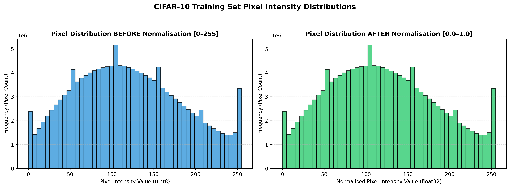
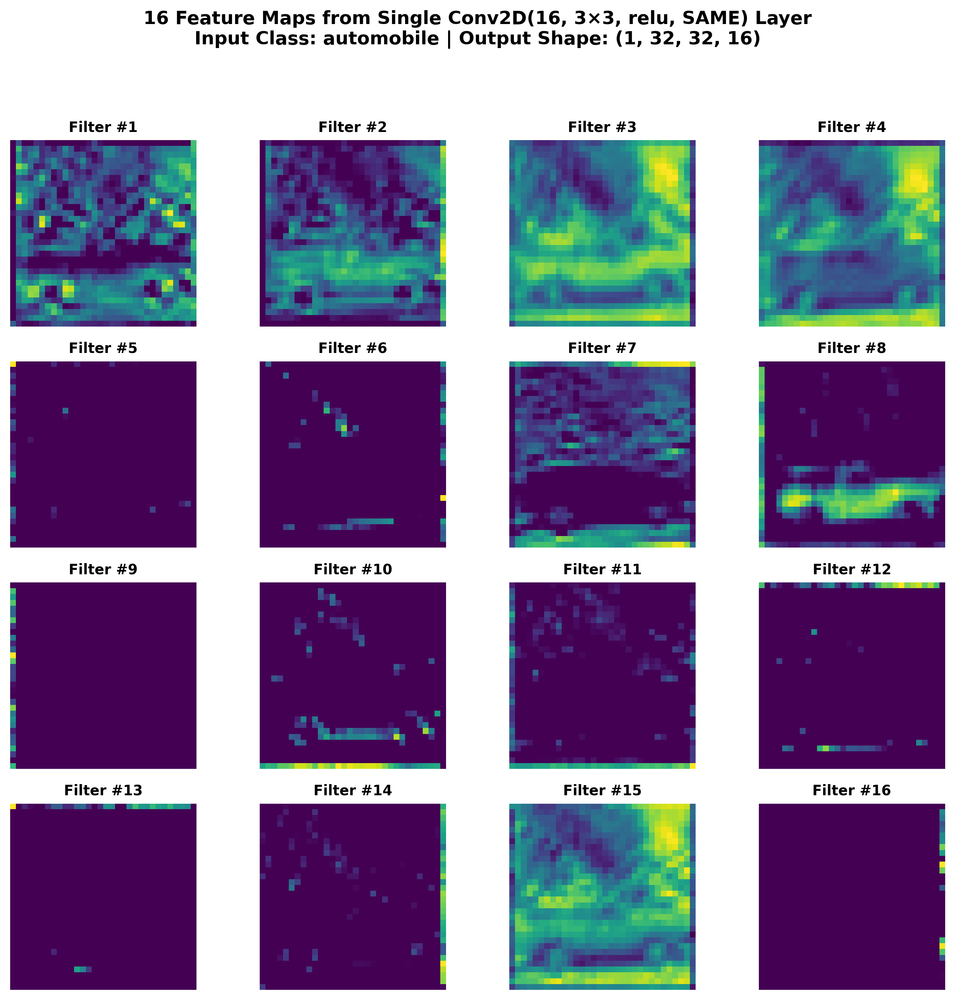
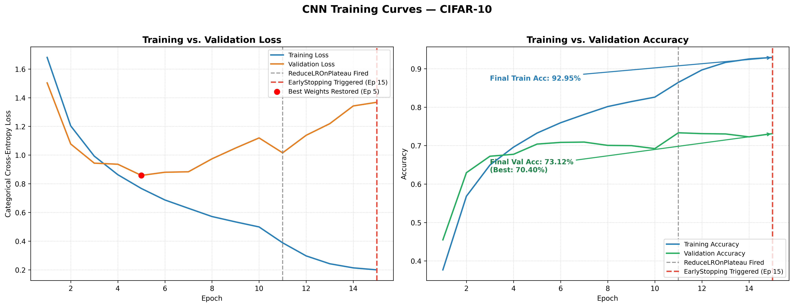

# CIFAR-10 Image Classification with CNN

A deep learning project exploring image processing and **Convolutional Neural Networks (CNNs)** using the CIFAR-10 dataset. This project covers image visualization, convolution operations, zero padding, pooling techniques, CNN training, and model evaluation.

## 📌 Project Overview

The **CIFAR-10 dataset** contains 60,000 colour images of size 32 × 32 pixels belonging to 10 different classes.

The dataset consists of:
- **50,000** training images
- **10,000** testing images
- **10 classes:** Airplane, Automobile, Bird, Cat, Deer, Dog, Frog, Horse, Ship, and Truck

The goal of this project is to understand fundamental image processing operations and explore how CNNs extract features from images to perform image classification.

## 🎥 Project Walkthrough

Explore the complete project walkthrough, including demonstrations and supporting files:

👉 **[Watch the Project Walkthrough on Google Drive](https://drive.google.com/drive/folders/17kQ6aaBN9A_0ZAEEwYBRBXGlxj-RJGc1?usp=drive_link)**


## 🎯 Project Objectives

- Explore and visualize the CIFAR-10 dataset.
- Analyze pixel intensity distributions using histograms.
- Understand convolution operations and zero padding.
- Visualize feature maps generated by convolutional layers.
- Compare max pooling and average pooling.
- Build and train a CNN for image classification.
- Evaluate model performance using training curves and a confusion matrix.

## 🛠️ Technologies Used

- **Language:** Python
- **Deep Learning:** TensorFlow and Keras
- **Numerical Computing:** NumPy
- **Data Analysis:** Pandas
- **Visualization:** Matplotlib
- **Environment:** Jupyter Notebook / Google Colab

## 📂 Dataset

This project uses the CIFAR-10 image dataset distributed through Kaggle.

**Dataset:** [CIFAR-10 Image Dataset (Original)](https://www.kaggle.com/datasets/abhiit/cifar-10-image-dataset-original)

The notebook uses the Kaggle CLI to download the dataset. You may need to configure your Kaggle API credentials before running the download cells.

Alternatively, download the dataset manually and update the notebook's dataset paths.

## 🔄 Project Workflow

### 1. Dataset Exploration
- Load and inspect the image dataset.
- Explore image dimensions and class labels.
- Visualize image samples and pixel intensity distributions.

### 2. Convolution Operations
- Implement a manual convolution operation.
- Demonstrate zero padding.
- Explore feature maps produced by convolutional layers.

### 3. Pooling Techniques
- Compare max pooling and average pooling.
- Understand how pooling reduces spatial dimensions while retaining important features.

### 4. CNN Model Training
- Build a Convolutional Neural Network using TensorFlow/Keras.
- Train the model on the CIFAR-10 dataset.
- Monitor training and validation performance.

### 5. Model Evaluation
- Visualize training and validation accuracy and loss.
- Analyze classification performance using a confusion matrix.
- Inspect misclassified images.

## 📊 Project Visualizations

### 1. Pixel Intensity Histograms

Visualizing pixel intensity distributions helps explore the characteristics of image data and understand how pixel values are distributed.



### 2. CNN Feature Maps

Feature maps illustrate how convolutional filters respond to visual patterns in images, helping demonstrate the feature-extraction process in CNNs.



### 3. CNN Training Curves

Training and validation curves help track model learning over epochs and identify potential overfitting or underfitting.



## 📁 Repository Structure

```text
Project_A/
│
├── DL_PR4.ipynb
│
├── models/
│
├── plots/
│   ├── a1_3_pixel_histograms.png
│   ├── a2_1_manual_convolution.png
│   ├── a2_2_zero_padding_demo.png
│   ├── a2_4_conv2d_feature_maps.png
│   ├── a3_1_max_vs_avg_pooling.png
│   ├── a4_3_cnn_training_curves.png
│   ├── a4_4_confusion_matrix.png
│   └── a4_4_misclassified_samples.png
│
└── README.md
```

## 🚀 How to Run the Project

### Step 1: Clone the Repository

```bash
git clone https://github.com/Deepvejpara/Deep-Learning-Projects.git
cd Deep-Learning-Projects/Project_A
```

### Step 2: Install Dependencies

Install the required Python libraries:

```bash
pip install tensorflow numpy pandas matplotlib jupyter kaggle
```

### Step 3: Prepare the Dataset

Configure your Kaggle API credentials if you want to download the dataset using the Kaggle CLI.

Alternatively, download the dataset manually and update the dataset paths in the notebook.

### Step 4: Run the Notebook

Open `DL_PR4.ipynb` in Jupyter Notebook or upload it to Google Colab.

Run the cells in order to explore the dataset, perform image processing operations, train the CNN, and evaluate its performance.

**Note:** A GPU can accelerate model training, but a compatible GPU is not mandatory.

## 🧠 Key Concepts Demonstrated

- Image data exploration
- Pixel intensity analysis
- Manual convolution
- Zero padding
- Convolutional feature extraction
- Max pooling and average pooling
- CNN architecture and training
- Training and validation analysis
- Confusion matrix
- Misclassification analysis

## 📌 Notes

- Dataset paths may need to be modified depending on your execution environment.
- Training results depend on the model architecture, hyperparameters, and training configuration.
- Refer to `DL_PR4.ipynb` for the complete implementation and additional visualizations.

## 👨‍💻 Author

**Deepvejpara**

GitHub: [Deepvejpara](https://github.com/Deepvejpara)

---

⭐ If you find this project useful, consider giving the repository a star!
